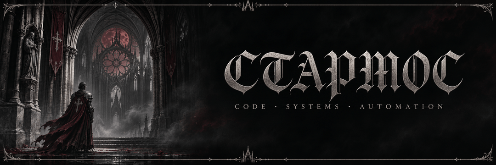
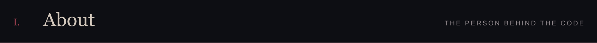
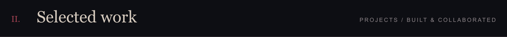
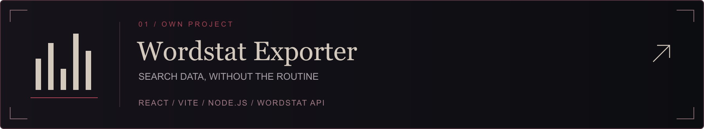
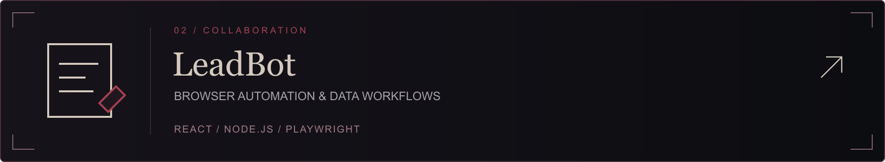
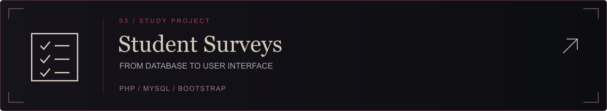
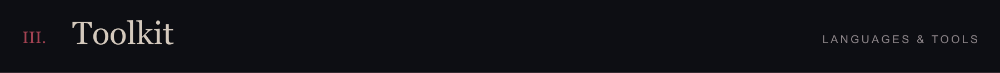
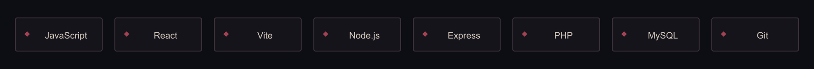

  

  <b>Веб-приложения · Работа с данными · Автоматизация</b> 
  Идея → код → инструмент, которым можно пользоваться.

  <a href="#selected-work">Проекты</a> &nbsp; · &nbsp;
  <a href="#toolkit">Технологии</a> &nbsp; · &nbsp;
  <a href="https://github.com/CTAPMOC?tab=repositories">Все репозитории</a>

Я — **CTAPMOC**. Разрабатываю веб-приложения и инструменты, которые помогают работать с данными и автоматизировать рутинные задачи.

В моих проектах — интерфейсы, серверная логика, интеграции с API и сохранение результатов. Особое внимание уделяю практическим деталям: понятным действиям, обработке ошибок и возможности продолжить работу после сбоя.

**[Wordstat Exporter](https://github.com/CTAPMOC/wordstat-exporter)** — сбор поисковых фраз через API Яндекса и выгрузка в Excel. История запусков, сохранение прогресса, обработка квот, остановка сбора и скачивание промежуточного результата.

**[LeadBot](https://github.com/powder-rose/lead-bot)** — совместный проект для работы с компаниями, сканирования сайтов и автоматизации форм обратной связи. Мои задачи в проекте: улучшение поиска форм, фильтров и скриншотов.

**[Student Surveys](https://github.com/CTAPMOC/Kursovaya-prjectpk8)** — учебное приложение для проведения опросов студентов: роли администратора и студента, управление опросами и вопросами, прохождение и просмотр агрегированных результатов.

  Frontend: JavaScript, React, Vite &nbsp; · &nbsp; Backend: Node.js, Express, PHP &nbsp; · &nbsp; Data: MySQL, REST API

 

