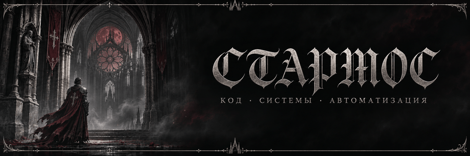
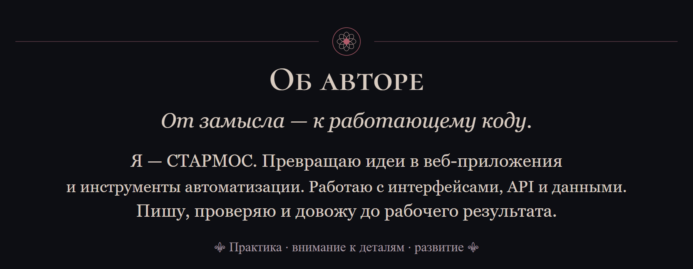
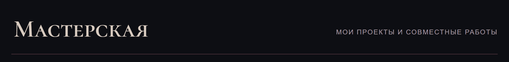
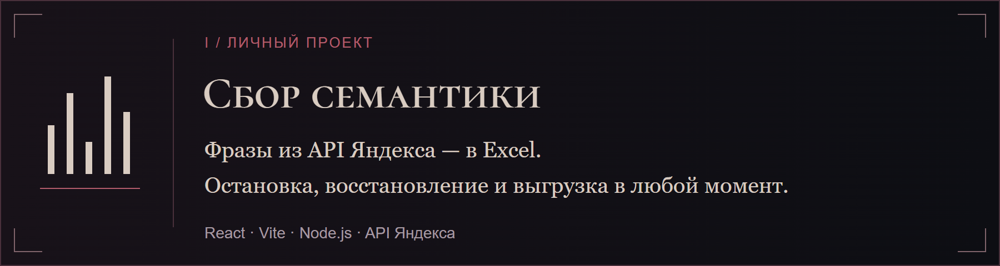
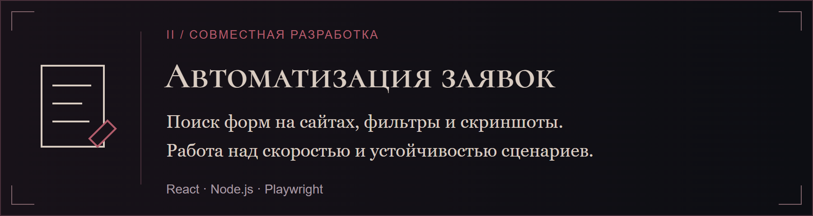
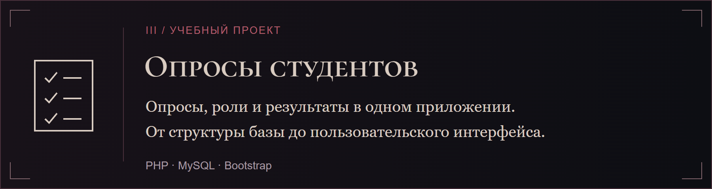
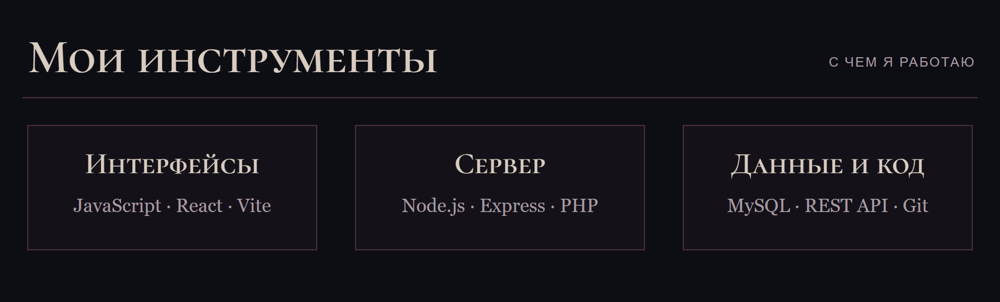
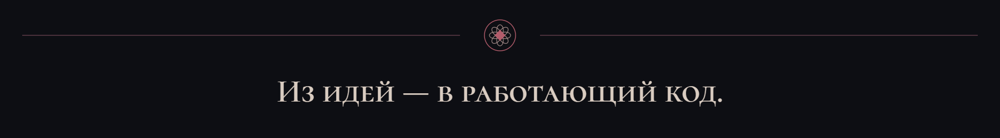

  <picture>
    <source media="(prefers-reduced-motion: reduce)" srcset="assets/gothic-banner-ru.png" />
    <source type="image/webp" srcset="assets/gothic-banner-ru-60.webp" />
    
  </picture>

  ⚜︎ &nbsp; <a href="#projects">Мастерская</a> &nbsp; ⟡ &nbsp;
  <a href="#tools">Инструменты</a> &nbsp; ⟡ &nbsp;
  <a href="https://github.com/CTAPMOC?tab=repositories">Все работы</a> &nbsp; ⚜︎

❦ О проектах — текстом и со ссылками

### Об авторе

Я — CTAPMOC. Превращаю идеи в веб-приложения и инструменты автоматизации. Работаю с интерфейсами, API и данными. Пишу, проверяю и довожу до рабочего результата.

### Мастерская

- **[Сбор семантики · Wordstat Exporter](https://github.com/CTAPMOC/wordstat-exporter)** — мой инструмент для работы с поисковыми фразами. Получает данные через API Яндекса и выгружает их в Excel. Сбор можно остановить, продолжить позже или скачать уже готовые результаты.
- **[Автоматизация заявок · LeadBot](https://github.com/powder-rose/lead-bot)** — совместная разработка. Моя работа в проекте связана с поиском форм на сайтах, фильтрами, скриншотами, скоростью и устойчивостью сценариев.
- **[Опросы студентов](https://github.com/CTAPMOC/Kursovaya-prjectpk8)** — учебное приложение на PHP и MySQL: создание опросов, роли администратора и студента, прохождение и просмотр результатов.

### Мои инструменты

Интерфейсы — JavaScript, React, Vite. Сервер — Node.js, Express, PHP. Данные и код — MySQL, REST API, Git.

